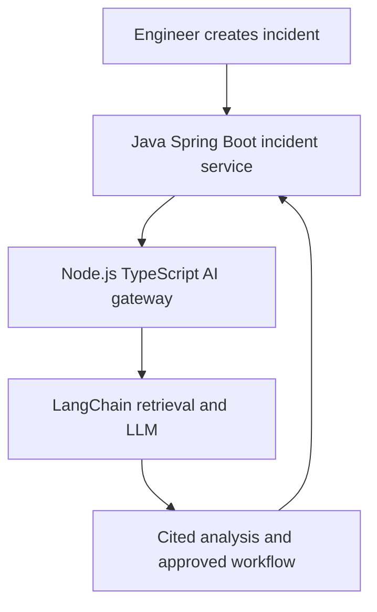

# OpsPilot

OpsPilot is a production-style incident intelligence platform combining Java, Node.js, and generative AI. It helps engineers investigate service incidents using logs, runbooks, and historical incident reports while keeping incident state and approvals in an auditable Java service.

## Why this project is strong

This is not a standalone chatbot. It demonstrates enterprise backend design, an AI integration layer, information retrieval, human approval, persistence, testing, and deployment.

- **Java 27 + Spring Boot:** authoritative incident workflow, validation, status transitions, persistence, versioning, and audit fields.
- **Node.js + TypeScript:** AI gateway, request validation, knowledge ingestion, LangChain orchestration, and provider abstraction.
- **LangChain:** document splitting, evidence prompt construction, model invocation, and structured analysis flow.
- **PostgreSQL:** incident storage and migration-managed schema.
- **Docker Compose:** reproducible local environment with PostgreSQL, Java, and Node services.
- **Grounding:** AI output carries retrieved source documents and quotes; weak evidence produces an abstention.

## Architecture



The Java service remains the system of record. The Node service can attach an AI analysis to an existing incident, but it cannot close or remediate an incident automatically.

## Quick start with Docker

Requirements: Docker Desktop with Docker Compose.

```bash
docker compose up --build
```

Services:

- Java API: `http://localhost:8080/actuator/health`
- Node AI API: `http://localhost:3000/health`
- PostgreSQL: `localhost:5432`

The local deterministic fallback works without an API key. For hosted generation, create a `.env` file in the project root:

```env
OPENAI_API_KEY=your-key
OPENAI_MODEL=gpt-4o-mini
```

Never commit that file.

## Example workflow

Create an incident in Java:

```bash
curl -X POST http://localhost:8080/api/v1/incidents \
  -H "Content-Type: application/json" \
  -d '{"title":"Checkout latency","serviceName":"checkout-service","description":"p95 latency increased after a configuration deployment","severity":"P2"}'
```

Use the returned incident ID with the Node LangChain service:

```bash
curl -X POST http://localhost:3000/v1/analyze \
  -H "Content-Type: application/json" \
  -d '{"incidentId":"PUT-ID-HERE","serviceName":"checkout-service","description":"p95 latency increased after a configuration deployment","logs":["database pool wait time increased","request timeout rate increased"],"persistToIncidentService":true}'
```

The response includes:

- probable causes
- recommended actions
- confidence
- abstention state
- retrieved source citations
- evidence quotes
- model/provider and latency trace

## Run without Docker

Java requires Java 27 and Maven. Node requires Node 20 or later.

Start PostgreSQL, then run the Java service:

```bash
cd java-service
mvn spring-boot:run
```

In a second terminal:

```bash
cd node-ai
npm install
npm run dev
```

Run checks:

```bash
cd java-service
mvn test

cd ../node-ai
npm run lint
npm test
```

## LangChain design

The Node service loads Markdown runbooks and historical incident documents, splits them into overlapping chunks, retrieves the most relevant evidence, and constructs a strict evidence-only prompt. If `OPENAI_API_KEY` is absent, it uses a deterministic grounded fallback so the architecture and tests remain runnable. With a key, it invokes an OpenAI-compatible chat model through LangChain.

The next production upgrade would replace the lexical retriever with a persistent `pgvector` retriever while preserving the analyzer interface and evaluation contract.

The local retriever builds an inverted index at startup. A query therefore visits posting lists for its terms rather than re-tokenising every document, reducing repeated query work as the knowledge base grows.

## Safety and reliability choices

- No automatic production changes are executed by the AI.
- Evidence is returned with source names and quotes.
- The service abstains when no indexed evidence clears the relevance threshold.
- Secrets are redacted by policy before external model calls in the documented workflow.
- The Java service stores the AI analysis ID, confidence, summary, timestamps, and optimistic-lock version.
- Human approval is required for rollback or configuration changes.

## Tests

The Java test covers incident creation, status transition, and attaching an AI analysis. The Node tests cover retrieval ranking and grounded fallback analysis. GitHub Actions runs both test suites and TypeScript checks on every push and pull request.

## CV-ready description

> Built OpsPilot, a production-style incident intelligence platform using Java Spring Boot and Node.js TypeScript microservices. Developed a LangChain-based RAG pipeline over service runbooks, logs, and historical incidents, returning citation-backed root-cause summaries and remediation recommendations. Implemented PostgreSQL persistence, validation, audit fields, Docker Compose deployment, automated tests, confidence-based abstention, and a human-approval workflow.

## Interview discussion points

1. Why Java remains the system of record while Node.js owns the AI integration boundary.
2. How RAG reduces unsupported recommendations and why citations still require verification.
3. Why the fallback provider is useful for reproducible tests and local development.
4. How optimistic locking prevents competing incident updates from silently overwriting each other.
5. How the design could evolve toward Kafka, pgvector, OpenTelemetry, and Kubernetes.

## Author

Gaurav Mahale
